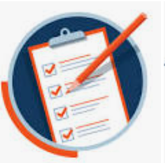
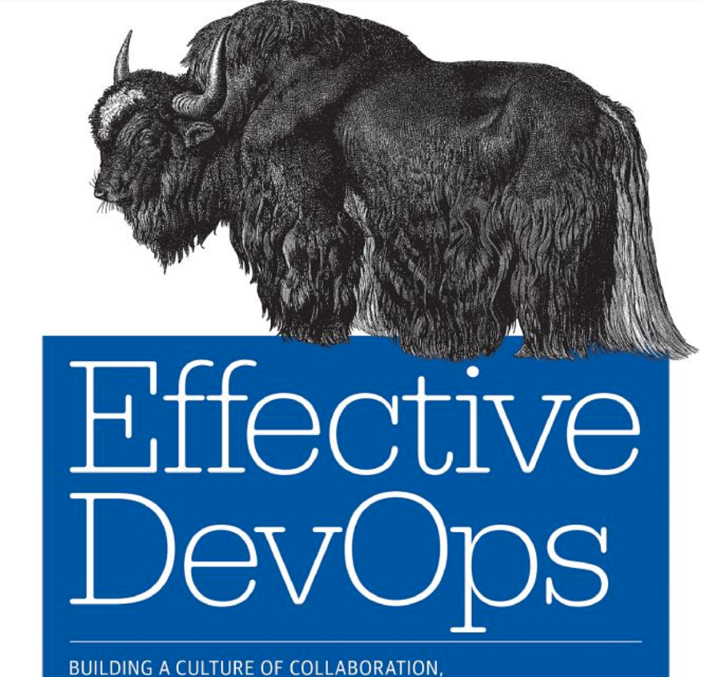
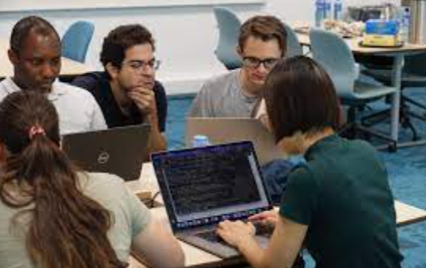
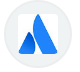
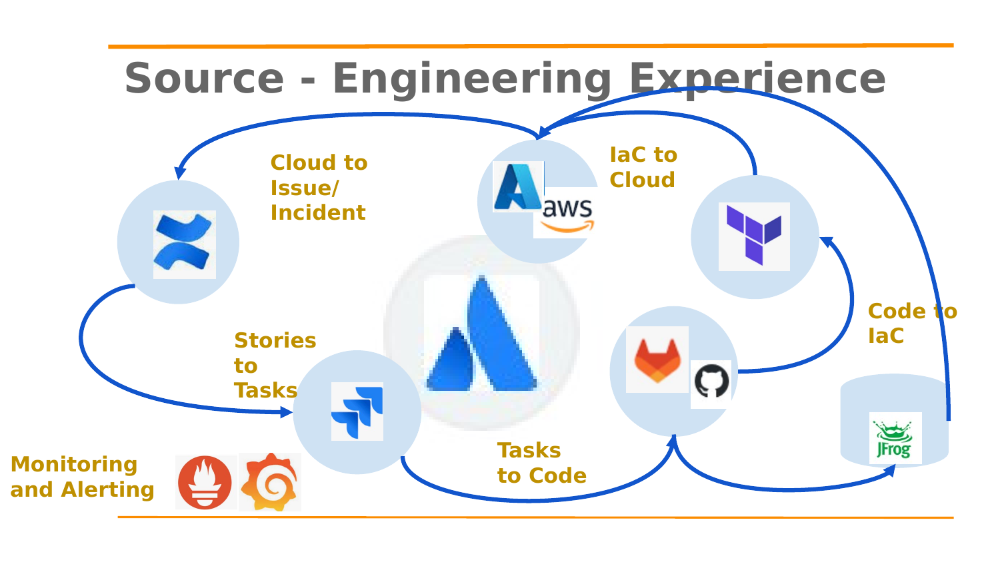
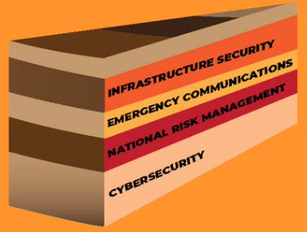
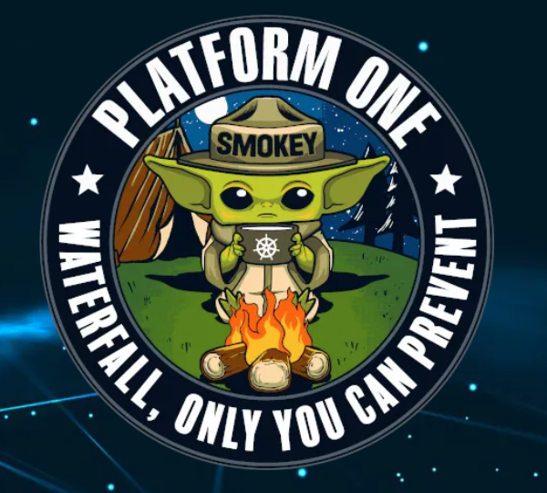
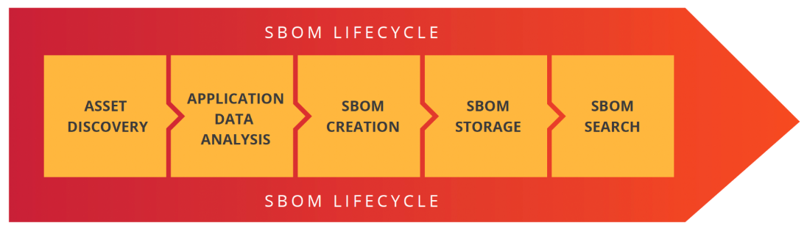
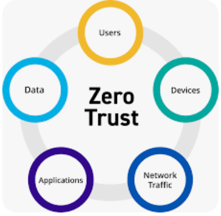

# Engineering Excellence & Digital Instrumentation

---

## 1. Agenda

- Professional Background
- Personal Information
- Leadership Philosophy
- Strategy — Vision, Setting, Tools
- Tooling
- Questions

**Format:** Interactive, entertaining — questions during the presentation welcome!

*Image: media.istockphoto.com*

---

## 2. Professional Background

Career progression:

- AI Engineer (C++)
- Tools team member at a quantitative investment firm (Eiffel)
- Architected a centralized, heterogeneous testing platform based on Atlassian at a global payments company (Java)
- Led three teams of release and quality assurance engineers
- Storage engineering at a cloud software company (Apache ZooKeeper)
- Cloud Foundry migration extending Move2Kube by Konveyor.io at a major bank (Go)

**Highlights**

- Half of career in Windows, then Linux
- Magazine cover feature in an AI trade publication
- Technical steering committee member
- Employee of the Month
- "Bake" sale for automated mobile testing
- Jira-based security remediation program
- Hosted an Apache ZooKeeper meetup
- Panelist on the Colonial Pipeline ransomware attack
- Panelist on the Silicon Valley Bank failure

---

## 3. Personal Information

- Grew up on the West and then East Coast
- World traveler
- Parent
- Foodie
- Endurance horseback rider
- Avid reader
- Learning the extended Berkeley Packet Filter (eBPF)
- Learning micro watering

---

## 4. Leadership Philosophy

- Goal-oriented
- Enablement
- Autonomy
- Reuse
- Improvement
- Team construction
- Servant leadership
- Following means listening
- Leading by example

**Teams led:** 30, 35, 50, and a matrixed team of 150

---

## 5. Break Down the Walls

- Who collects a bunch of books with animals on them?
- First "soft skills" book published by O'Reilly
- A well-known Harvard Business Review article argued IT was unnecessary

---

## 6. Instrument Patterns

- Automatic federation
- Engineering sandboxes
- Smart certificate renewal
- Synthetic data

*Who has walked to get water in the middle of the night and stepped on one of these?* (Lego bricks)

---

## 7. Build It, They Will Come

At a prep school, responsible for social events: if students got in trouble, then our event planning had failed them.

*Image: sage.com*

---

## 8. Atlassian Transparency & the Engineering Experience

- Open culture
- Shared work
- Cross-disciplinary approach
- Frameworks
- Services
- Tools
- Atlassian automated transparency
- Tech-first company

---

## 9. Source — Engineering Experience

1. Stories to tasks
2. Tasks to code
3. Code to IaC
4. IaC to cloud
5. Cloud to issue/incident
6. Monitoring and alerting
7. Tooling and instrumentation

---

## 10. Baked-In Security

- Build pipelines with SonarQube, Checkmarx, and Black Duck
- Encryption at rest and in transit patterns
- OWASP Top 10
- Multi-factor authentication
- Secure coding practices and Secure Code Warrior training

*Image: x.com*

---

## 11. Secure and Defensible

*Image: p1.dso.mil*

*Image: securestack.com*

*Image: logrhythm.com*

---

## 12. Questions?

Thank you!
