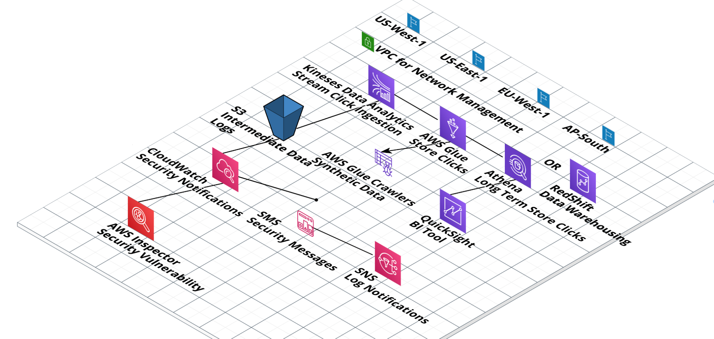

# Multi-Tenant Clickstream Design

---

## 1. Architectural Diagram


**Recommendation:** AWS data lake implementation with AWS BI tooling and logging



**Components shown**

- **Regions:** US-West-1, US-East-1, EU-West-1, AP-South
- **Network:** VPC for network management
- **Ingestion:** Kinesis Data Analytics stream for click ingestion
- **Storage:** S3 for intermediate data, synthetic data, and logs; AWS Glue to store clicks; AWS Glue crawlers
- **Query and warehousing:** Athena for long-term click storage, or Redshift for data warehousing
- **BI:** QuickSight
- **Security and logging:** CloudWatch security notifications, AWS Inspector for security vulnerabilities, SMS security messages, SNS log notifications

---

## 2. Multi-Tenant Identity and Considerations

**Multi-tenant identity header**

```
Customer-ID | Region | Click Data…
```

**Considerations**

- GDPR
- High availability
- Synthetic data
- Training model
- Data gaps
- Data life
- Log archival
- Seasonality

---

## 3. Requirements

- Capture data from client applications in multiple geographic regions
- Support a BI tool that interfaces with the data warehouse
- Provide automated workflows for generating reports
- Support workflows that require extremely high integrity, such as financial reporting
- Logging and monitoring

---

## 4. Alternatives

**BI tools**

- $ — eazyBI (Jira plug-in)
- $$$ — Adobe Analytics Analysis Workspace (formerly Omniture)
- $$ — Domo (Challenger in the Gartner Magic Quadrant)

**Logging**

- $ — Grafana or Prometheus
- $$$ — Splunk
