# Putting the "Sec" into DevOps

---

## 1. Agenda

- Dev + Sec + Ops
- It's a Social Problem!
- Open Web Application Security Project (OWASP) 2017: Security in DevOps
- Penetration Testing Overview
- Governance and Behavioral Challenges
- Financial Services: Moving the Needle
- Autonomous Vehicles: Educating Product Managers

---

## 2. Dev + Sec + Ops

**Developer**

- IBM Presentation Manager (PS/2) in an artificial intelligence (AI) lab
- C++ Microsoft Foundation Classes
- Eiffel / Java test sign-off workflow via MQ services with auto-release

**"Sec" for Security**

- Penetration testing in financial services

**Operations**

- DevOps for sending money, energy, mobile apps, and autonomous vehicles

---

## 3. It's a Social Problem — 2007

*Please release my code!*


---

## 4. It's a Social Problem — 2008 to Present

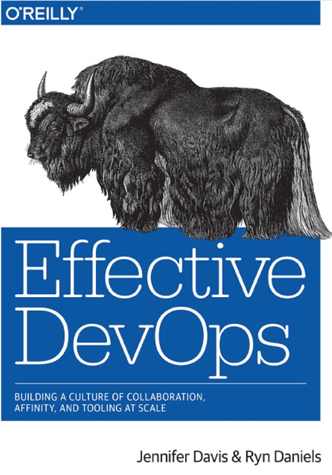 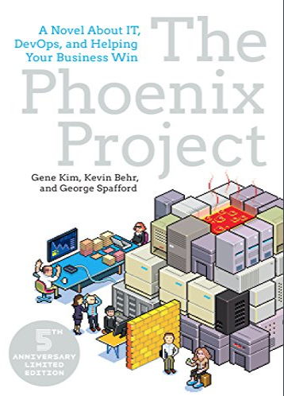

---

## 5. It's a Social Problem — A Timeline

- **Visual SourceSafe, 1993** — Why do I have to check in my code?
- **Web-olution, 1999** — ILOVEYOU worm
- **SOX IT 404 controls, 2005** — Why do we have to branch our code? Why should I put comments when I check in my code?
- **It's Gone to the Dogs!, 2014** — POODLE vulnerability

---

## 6. It's a Social Problem

*Have you hugged your InfoSec person today?*

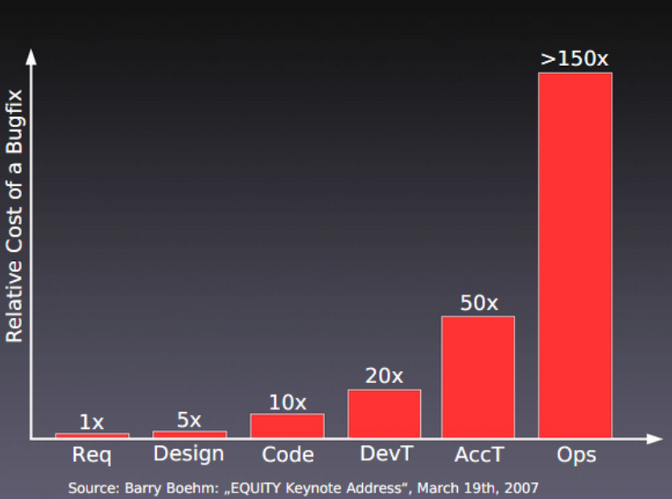

---

## 7. Secure Coding — InfoSec Is Us!

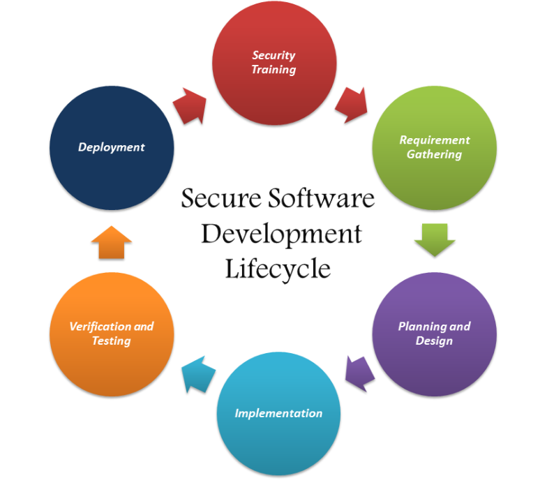

---

## 8. OWASP — Security 2017 & DevOps


---

## 9. OWASP — Top 10 Security Vulnerabilities (2017)

1. Injection
2. Broken Authentication
3. Sensitive Data Exposure
4. XML External Entities (XXE)
5. Broken Access Control
6. Security Misconfiguration
7. Cross-Site Scripting (XSS)
8. Insecure Deserialization
9. Using Components with Known Vulnerabilities
10. Insufficient Logging & Monitoring

---

## 10. Penetration Testing Overview

Other types: perimeter, vulnerability, offensive

**Example findings**

- One-letter Oracle password for admin
- Unlimited password retries
- Dump of user passwords
- XML External Entities (XXE) — access other users' information
- Access to the admin page
- Default Tomcat directories left in place
- Gain admin by deserializing the message
- Patching lag for known library vulnerabilities
- Not logging enough

---

## 11. Hidden Pictures — Can You Find the Vulnerability?

### A1: Injection

```sql
select title, text from news where id=$id
```

```sql
SELECT * FROM Users WHERE ((Username='1' or '1' = '1'))/*') AND (Password=MD5('$password')))
```

```sql
SELECT Name, Phone, Address FROM Users WHERE Id=1 UNION ALL SELECT creditCardNumber,1,1 FROM CreditCardTable
```

---

## 12. A2: Authentication

Oracle admin password = `'A'`

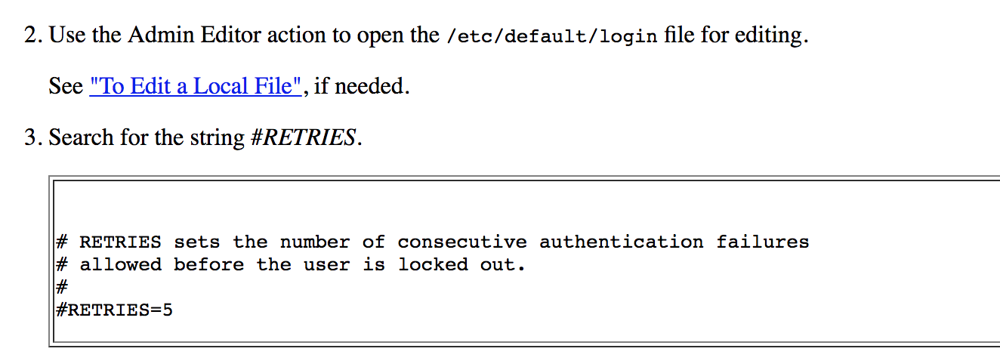

---

## 13. A3: Sensitive Data

- Weak encryption
- *What is the dog breed related to this topic?*
- Mail server certificate checking
- *Which of these utensils is useful to protect sensitive data? Knife, fork, salt*

---

## 14. A4: XML External Entity Processing

```xml
<?xml version="1.0" encoding="ISO-8859-1"?>
<!DOCTYPE foo [
  <!ELEMENT foo ANY >
  <!ENTITY xxe SYSTEM "file:///dev/random" >]>
<foo>&xxe;</foo>
```

```xml
<?xml version="1.0" encoding="ISO-8859-1"?>
<!DOCTYPE foo [
  <!ELEMENT foo ANY >
  <!ENTITY xxe SYSTEM "expect://id" >]>
<creds>
  <user>&xxe;</user>
  <pass>mypass</pass>
</creds>
```

---

## 15. A5: Access Control

- *Why is the SOAP API deprecated in favor of the REST API?*
- Traverse to an admin page
- Change JSON token

---

## 16. A6: Misconfiguration

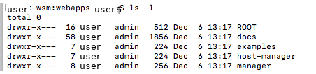

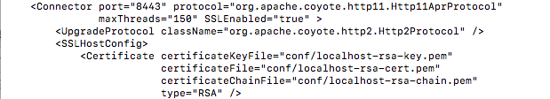

---

## 17. A7: Cross-Site Scripting

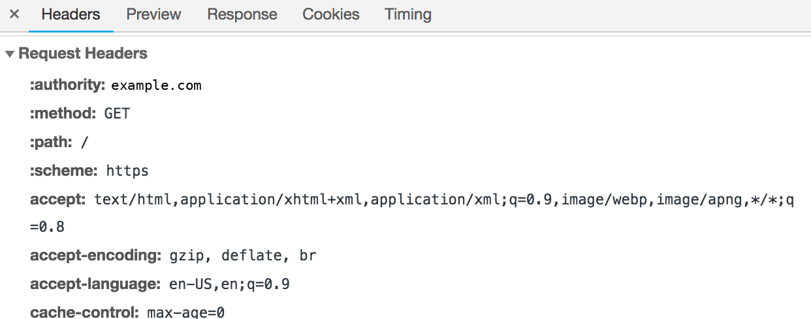

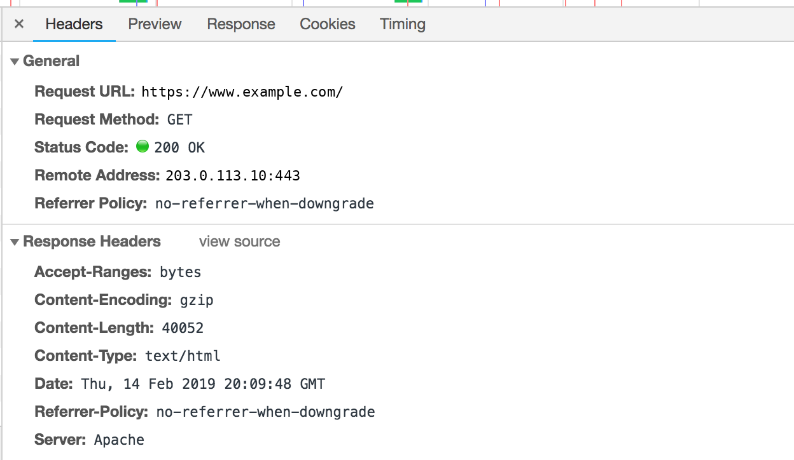

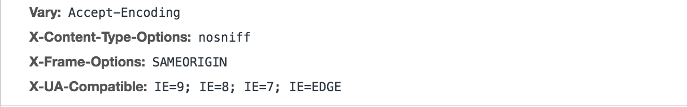

---

## 18. A8: Deserialization

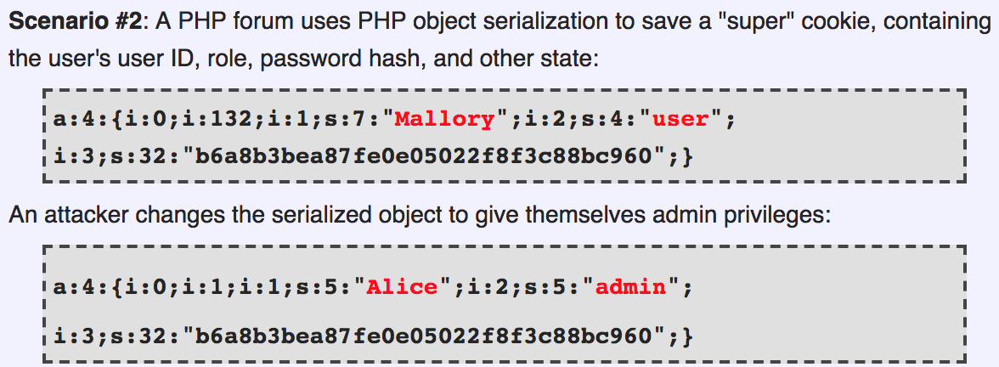

---

## 19. A9: Known Vulnerabilities

- Apache Struts
- *Taking the "latest" from open source — is that a good thing?*

---

## 20. A10: Logging & Monitoring

- Have you ever cringed when you get the sudo error "This incident will be reported"?
- Or gotten a "love" letter from IT when you mailed yourself a log file from a production server?

---

## 21. Reporting Issues

SD Elements

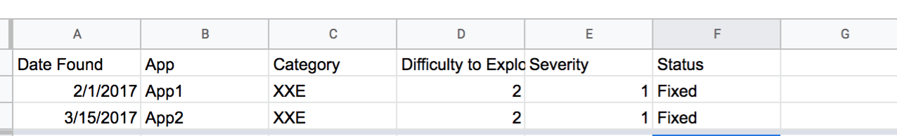

---

## 22. Jira Transformation — What Is There to Hide?

Slicing and dicing with labels

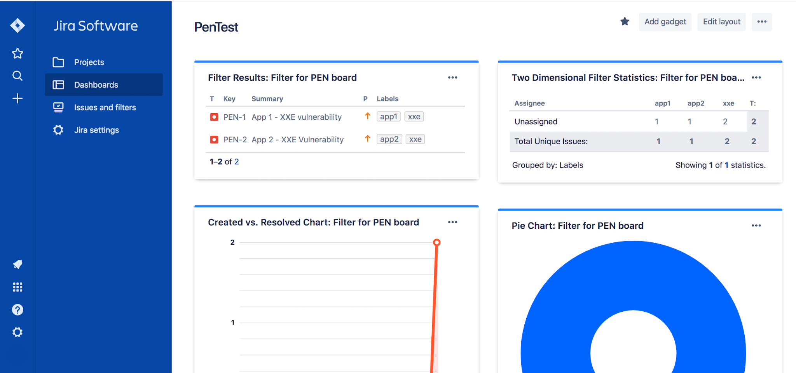

---

## 23. Pentest Scoring — How Do You Score?

- 3 represents the top of a normal distribution in terms of difficulty to exploit and severity of the vulnerability
- Security grades companies based on a score from 1 to 5

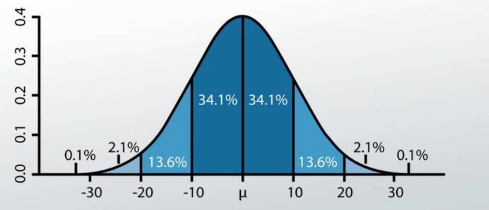

---

## 24. Code Diffs — Solves the Social Problem

- [git-secrets](https://github.com/awslabs/git-secrets)
- HashiCorp Vault and its API

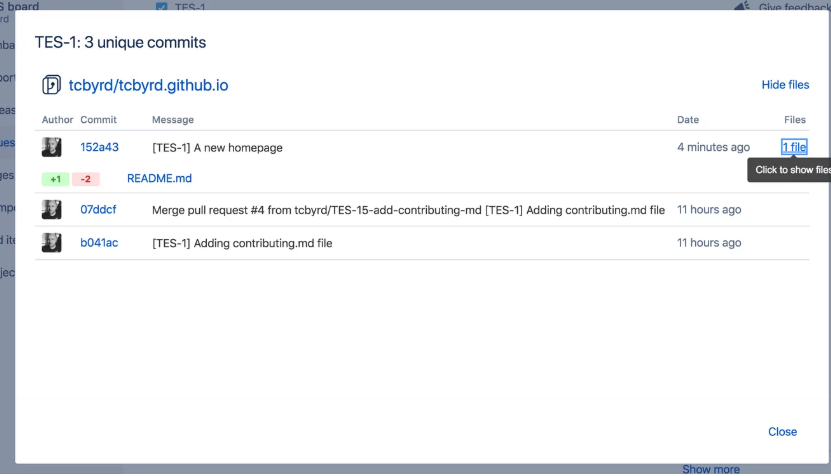

---

## Thank You!
